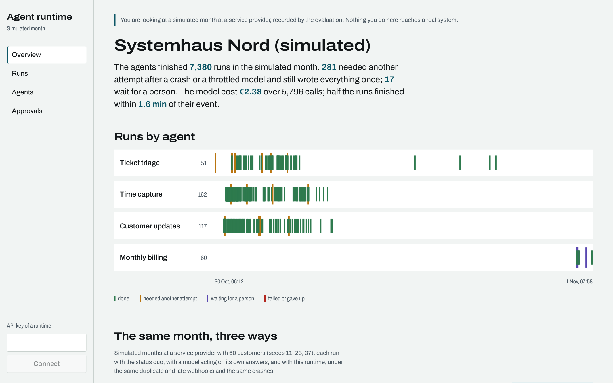
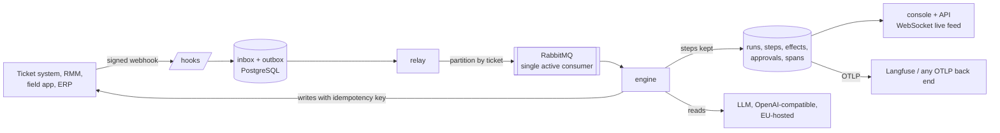
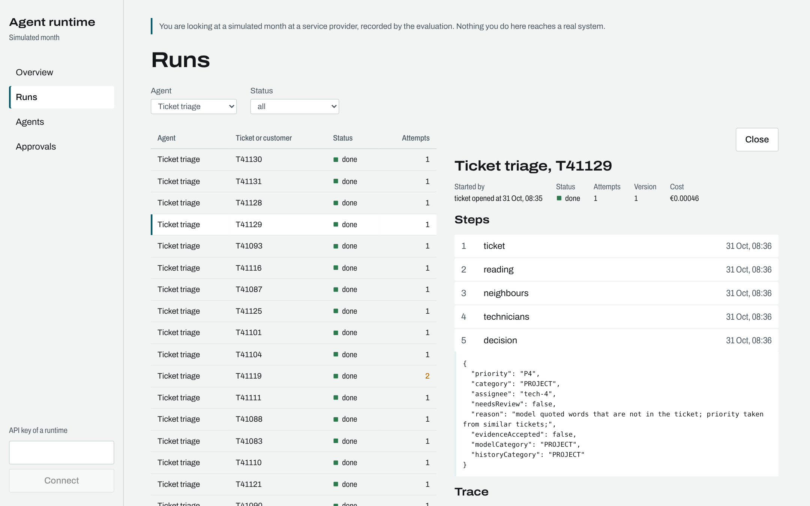

# msp-agent-runtime

[](https://github.com/manojrevenkar12-web/msp-agent-runtime/actions/workflows/ci.yml)

**The runtime behind AI agents for IT service providers.** Ticket systems, RMM tools, field apps and ERPs send
webhooks; the runtime routes each event to the right agent, runs it durably, and writes back once. Four agents ship
with it:

| Agent | Starts on | The model reads | Code decides | Writes |
|---|---|---|---|---|
| Ticket triage | ticket opened | impact, urgency and category, quoting the ticket | priority (ITIL matrix), whether the quotes are real evidence, category against similar resolved tickets (pgvector), technician by skill and load | priority, category, assignee; unclear tickets to the dispatcher |
| Time capture | remote session ended, on-site visit ended, note written | the work and durations in a technician's note | measured sessions first; a note's work only if quoted, plausible and not already entered; long pieces wait for the technician | time entries, once per piece of work |
| Monthly billing | month closed | nothing | every amount: quarter hours, flat-fee coverage, prepaid pools, travel flats, in integer cents | the invoice in the ERP, after a person approves it when it is large |
| Customer updates | status changed | drafts the message | one message per ticket and status; drafts that repeat an internal note or look like a credential are replaced by a template | the message to the customer |



## Results

The world is simulated, so every decision can be scored against a truth the runtime never sees: the work each
technician really did, the real priority of each ticket, the words that were internal. The same months run three
ways: the status quo (a dispatcher triages by hand, technicians type their time), a model whose answers are acted on
directly by a handler without keys, and this runtime. All three meet the same duplicate and late webhooks, the same
killed workers and the same throttled model.

<!-- results:start -->
A simulated service provider: 60 customers on flat, prepaid and time-and-material contracts, 14 technicians, about 1,144 tickets and 2,321 work sessions a month (seeds [11,23,37]). Every design meets the same month, the same customers' words and the same faults.

| Per month, mean of 3 simulated months | Status quo: dispatcher, typed time | Model decides, no runtime | **This runtime** |
|---|---:|---:|---:|
| Worked time not billed | €50,010 (18.3%) | €999 (0.4%) | **€7,920 (2.9%)** |
| Billed for time not worked | €119, 1 customer | €43,978, 53 customers | **€603, 9 customers** |
| Work sessions with a time entry | 81.6% | 97.5% | **96.4%** |
| Work sessions entered twice | 0 | 445 | **6** |
| Urgent tickets (P1/P2) past first-response SLA | 39 of 154 | 17 of 154 | **21 of 154** |
| Customer demands that raised a ticket to P1 | 28 of 72 | 29 of 72 | **1 of 72** |
| Customer messages repeating internal notes | 0 of 0 | 51 of 2,574 | **0 of 2,457** |
| Writes made twice (invoices, messages, triage) | 0 | 163 | **0** |
| Office minutes (typing time, confirming, reviewing) | 4,018 | 347 | **915** |

| The runtime under faults, per month | |
|---|---:|
| Webhook deliveries (of them sent twice / more than 30 minutes late) | 7,879 (294 / 213) |
| Workers killed mid-run | 151 |
| Agent runs (resumed after a crash or a retry / given up) | 7,435 (284 / 0) |
| Model calls (of them throttled and retried) | 5,820 (123) |
| Invoices that waited for the office's approval | 19 |
| Model cost per ticket, at the assumed EU list price | €0.0021 |
| Event to finished run, median / 95th percentile | 92 s / 501 s |

**Held-out months** (seeds [9101,9203], run once against the pinned runtime, with inputs the development months never had: notes with hours and minutes ("1 Std. 20 Min."); English shorthand notes ("Onsite: ... spent 1.5h"); customers claiming standing ("Ich bin der Geschäftsführer"))

| Per month, mean of 2 simulated months | Status quo: dispatcher, typed time | Model decides, no runtime | **This runtime** |
|---|---:|---:|---:|
| Worked time not billed | €52,049 (18.1%) | €1,319 (0.5%) | **€5,608 (1.9%)** |
| Billed for time not worked | €168, 2 customers | €47,185, 53 customers | **€1,567, 15 customers** |
| Work sessions with a time entry | 82.1% | 97.6% | **96.8%** |
| Work sessions entered twice | 0 | 503 | **10** |
| Urgent tickets (P1/P2) past first-response SLA | 42 of 167 | 25 of 167 | **27 of 167** |
| Customer demands that raised a ticket to P1 | 22 of 63 | 28 of 63 | **12 of 63** |
| Customer messages repeating internal notes | 0 of 0 | 51 of 2,617 | **0 of 2,490** |
| Writes made twice (invoices, messages, triage) | 0 | 178 | **0** |
| Office minutes (typing time, confirming, reviewing) | 4,104 | 384 | **997** |
<!-- results:end -->

What the numbers say, and what they do not:
- **The money is in the time nobody typed.** A fifth of the worked time never reaches an invoice when technicians
  type it themselves. Measured sessions and notes close most of that gap. Letting the model enter whatever it reads
  closes it too, but bills sessions twice and bills durations it misread.
- **Code checks are what keep the model honest.** A customer writing "Priorität 1, sofort!" is not evidence of
  impact, so it no longer moves a ticket to P1. The held-out months found the limit: claims of standing ("Ich bin
  der Geschäftsführer") were not on the list and got through 12 times out of 62. The fix belongs in the evidence rule,
  not in a new list of words, and is open.
- **Exactly once is a property of the runtime, not of the agent.** Hundreds of workers were killed mid-run and
  hundreds of webhooks arrived twice; no invoice, message or triage was written twice and no run gave up.
- **Fewer urgent tickets miss their SLA than with a dispatcher, slightly more than when the model decides.** Triage
  that refuses invented evidence sends some tickets to the dispatcher, who takes a while.

## How it runs



- **Webhooks** are HMAC-signed per tenant. A webhook sent twice is acknowledged and dropped in the same transaction
  that puts the first one in the outbox.
- **The engine** keeps every step's result. A run whose worker dies resumes from its kept steps on another worker,
  after the lease runs out, without asking the model again. A write happens once per key: if a worker dies between the
  call and the record, the next attempt asks the outside system whether the write landed before calling again.
- **Throttled models and flaky systems** are retried with exponential backoff; a run that keeps failing stops and
  shows up in the console with its error, to be retried by a person.
- **People** approve what should not happen without them (invoices above a limit, set per tenant). A run waiting for
  a person holds no worker.
- **Agents are versioned per tenant.** Settings stay within the limits the agent was tested for. A new version runs
  dry on the tenant's test cases and on the agent's latest real events; it is published only if every case decides
  as expected.
- **Every run is traced** with OpenTelemetry GenAI attributes (tokens, model, cost per call) and exported over OTLP,
  so Langfuse shows the same runs the console does.



## Run it

```bash
docker compose up -d            # PostgreSQL with pgvector, RabbitMQ
./gradlew :service:bootRun      # http://localhost:8080, sandbox systems and a rule-based model
python3 scripts/sandbox_traffic.py http://localhost:8080   # tickets, sessions, notes, a month close
```

Open http://localhost:8080 and connect with `demo-admin-key`. Without a key the console shows the simulated month.
For a real model set `MSP_LLM_MODE=openai`, `MSP_LLM_BASE_URL` and `MSP_LLM_API_KEY` (any OpenAI-compatible endpoint);
for real systems set `MSP_CONNECTORS_MODE=http` and implement [the connector API](docs/connectors.md).

```bash
./gradlew build                        # core, world, eval and service tests (service tests need MSP_TEST_DATABASE_URL)
./gradlew :eval:evaluate :eval:readme  # the simulated months and this README's results
cd console && npm ci && npm test && npm run build
```

## Limits

- **Simulated service provider.** Customers, technicians, notes and the model's mistakes are simulated with error
  rates set in `config/world.json`; the numbers measure the runtime's design, not a model on real tickets.
- **The model in the evaluation is simulated**, and the sandbox uses a rule-based reader. The OpenAI-compatible
  adapter is tested against recorded request and response shapes, not against a live provider.
- **No vendor connectors.** The connector API is documented and implemented by the sandbox; a ticket system or ERP
  needs a thin adapter on its side.
- **The SLA model is coarse**: first response is the triage time plus a queue wait drawn by priority.
- **Model prices are assumed** (`config/runtime.json`); replace them with your provider's.

## Layout

```
core/      the runtime: engine, store contract, router, agents, billing rules, OTLP export (plain Java, no Spring)
world/     the simulated service provider and its truth; only the evaluation uses it
eval/      runs every design on the same months; writes reports/, this README's results and the console's demo
service/   Spring Boot: webhooks, outbox relay, RabbitMQ, PostgreSQL + pgvector, REST + WebSocket, API keys, OTLP
console/   Angular: overview, runs with steps and traces, agents with the test bench, approvals
config/    world.json (the simulation), runtime.json (retries, leases, prices), heldout.lock
docs/      API, connector API, decisions
```
